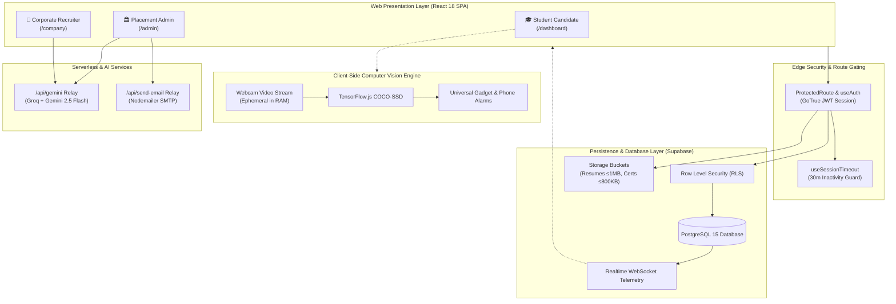

# 🎓 Intelligent Placement Management System (IPMS Elite v3.1)

> **Enterprise-Grade Autonomous Campus Placement, AI Anti-Cheat Proctoring & Recruitment Intelligence Ecosystem**

[](https://github.com/RoshanGowdaR/Intelligent-Placement-Management-System/actions)
[](https://vitest.dev/)
[](https://www.typescriptlang.org/)
[](https://reactjs.org/)
[](https://supabase.com/)
[](LICENSE)
[](https://intelligent-placement-management-sy.vercel.app)

---

## 📑 Table of Contents
1. [Executive Summary & Problem Solved](#-executive-summary--problem-solved)
2. [Role-Based Access & Feature Matrix](#-role-based-access--feature-matrix)
3. [System Architecture & End-to-End Data Flow](#-system-architecture--end-to-end-data-flow)
4. [Installation & Verified Execution Steps](#-installation--verified-execution-steps)
5. [Environment Variables & Configuration](#-environment-variables--configuration)
6. [Database Schema & Data Dictionary](#-database-schema--data-dictionary)
7. [API Endpoints & Serverless Specifications](#-api-endpoints--serverless-specifications)
8. [Computer Vision & Anti-Cheat Proctoring Pipeline](#-computer-vision--anti-cheat-proctoring-pipeline)
9. [Placement AI Oracle Assistant & Generative UI](#-placement-ai-oracle-assistant--generative-ui)
10. [Automated Testing & Quality Assurance](#-automated-testing--quality-assurance)
11. [Containerization & Docker Execution](#-containerization--docker-execution)
12. [Production Deployment Guide](#-production-deployment-guide)
13. [Production Readiness Checklist](#-production-readiness-checklist)
14. [Known Limitations & Future Roadmap](#-known-limitations--future-roadmap)
15. [Contributing & License](#-contributing--license)

---

## 🌟 Executive Summary & Problem Solved

Traditional university campus placements rely heavily on unverified spreadsheets, fragmented messaging apps, and unsupervised online exams vulnerable to rampant cheating.

**IPMS Elite** transforms campus recruitment into an autonomous, forensic-grade, AI-orchestrated platform:
- **Zero-Trust Proctoring**: Client-side computer vision (TensorFlow.js COCO-SSD) detects digital gadgets and unauthorized devices in real time with zero video upload or privacy compromise.
- **Automated Sequential Drive Gating**: Dynamically enforces recruitment rounds (Round 1 &rarr; Round 2 &rarr; Round 3) using customizable passing logic (`cutoff_score`, `top_n`, `top_percent`).
- **Placement AI Oracle**: A live database intelligence engine (Google Gemini 2.5 Flash / Groq) that synthesizes institutional telemetry into interactive Recharts bar charts, KPI cards, and forensic audit logs.
- **Strict Storage Quotas**: Prevents server blowouts by enforcing document quotas (Resume $\le 1$ MB, Certificates $\le 800$ KB, Avatars $\le 500$ KB) designed for university free-tier constraints.

---

## 🧭 Role-Based Access & Feature Matrix

| Feature Module | 🎓 Student Candidate (`/dashboard`) | 🏛️ Placement Admin (`/admin`) | 🏢 Visiting Recruiter (`/company`) |
| :--- | :---: | :---: | :---: |
| **Profile Studio & Document Quotas** | Edit details, upload resumes ($\le 1$MB), certs | Audit candidate documents | View verified applicant profiles |
| **Assessment Registration** | Self-register for active drives | Open/Close registration windows | Manage company-specific cutoffs |
| **Live Proctored Exam Engine** | Fullscreen lock, webcam CV, auto-submit | Live proctor feeds & audit logs | Review applicant proctor summaries |
| **Recruitment Drive Rounds** | Track drive progress timeline | Campus-wide round oversight | Configure sequential hiring rounds |
| **AI Question Bank Generator** | Personalized post-test revision plans | Synthesize MCQs with Groq/Gemini | Author tailored technical tests |
| **Placement AI Assistant** | Career mentoring & MCQ practice | Live institutional database RAG | Company-scoped hiring pipeline AI |
| **Notification Feed** | Persistent sidebar notifications | Institutional system notifications | Candidate application alerts |
| **Analytics & PDF Reports** | Personal score card & percentile | NIRF/NAAC placement reports | Exportable CSV candidate rosters |

---

## 🏗️ System Architecture & End-to-End Data Flow



---

## ⚡ Installation & Verified Execution Steps

### Prerequisites
- **Node.js**: `v20.x` or higher (Active LTS)
- **npm**: `v10.x` or higher
- **Git**: Installed

### Step-by-Step Setup

```bash
# 1. Clone the repository
git clone https://github.com/RoshanGowdaR/Intelligent-Placement-Management-System.git
cd Intelligent-Placement-Management-System

# 2. Install dependencies with strict lockfile resolution
npm ci

# 3. Create and configure environment variables
cp .env.example .env
# Edit .env with your Supabase credentials (see next section)

# 4. Start local development server
npm run dev
# The application will launch at http://localhost:5173
```

### Verified Development Scripts
```bash
npm run dev           # Start Vite local HMR server (http://localhost:5173)
npm run typecheck     # Verify 0 TypeScript errors (tsc --noEmit)
npm run lint          # Run ESLint across codebase
npm test              # Run full Vitest suite (14 suites, 67 tests)
npm run test:backend  # Run backend recruitment & proctor engine tests
npm run build         # Production bundling with Vite (dist/)
npm run preview       # Preview production build locally
```

---

## 🔐 Environment Variables & Configuration

Create a `.env` file in the root directory:

```env
# Supabase Database & Auth Configuration
VITE_SUPABASE_URL="https://your-project.supabase.co"
VITE_SUPABASE_PUBLISHABLE_KEY="sb_publishable_your_key_here"

# AI Inference Providers (Serverless Relay & Client)
VITE_GROQ_API_KEY="gsk_your_groq_api_key"
VITE_GEMINI_API_KEY="AIzaSy_your_primary_gemini_key"
VITE_GEMINI_API_KEY_BACKUP="AQ.Ab8RN6K7..._backup_key"

# Email Delivery SMTP Relay (Optional for invitation emails)
GMAIL_USER="placement-office@university.edu"
GMAIL_APP_PASSWORD="your-app-specific-password"
```

---

## 🗄️ Database Schema & Data Dictionary

| Table Name | Primary Key | Key Foreign Keys | Key Columns | Row Level Security (RLS) Policy |
| :--- | :--- | :--- | :--- | :--- |
| `profiles` | `id` (UUID) | `auth.users(id)` | `name`, `email`, `usn`, `branch`, `cgpa`, `backlogs`, `resume_url`, `skills`, `marks_cards` | Users read/update own profile; Admins have read access. |
| `companies` | `id` (UUID) | `user_id` &rarr; `auth.users` | `name`, `job_role`, `salary_package`, `eligibility_criteria`, `allowed_branches`, `logo_url` | Public read; Admins & Recruiter owners manage. |
| `tests` | `id` (UUID) | `company_id` &rarr; `companies` | `title`, `duration`, `scheduled_date`, `pass_criteria`, `question_bank`, `questions_per_student` | Anyone can view scheduled tests; Admins/Companies manage. |
| `test_attempts`| `id` (UUID) | `test_id`, `student_id` | `total_score`, `passed`, `tab_switches`, `auto_submitted`, `proctor_events`, `scores` | Students view own attempts; Admins/Companies view candidate scores. |
| `drive_rounds` | `id` (UUID) | `company_id` &rarr; `companies` | `round_number`, `round_name`, `round_type`, `passing_logic`, `passing_value`, `auto_progress` | Students view published rounds; Companies configure pipeline. |
| `round_participants`| `id` (UUID)| `drive_round_id`, `student_id` | `status` (`qualified`, `not_qualified`), `score`, `recruiter_notes`, `evaluated_at` | Students view own status; Companies manage evaluations. |
| `notifications`| `id` (UUID) | `user_id` &rarr; `auth.users` | `title`, `message`, `type`, `read`, `link`, `created_at` | Users manage own notification feed. |

---

## 🌐 API Endpoints & Serverless Specifications

### 1. `POST /api/gemini`
Serverless proxy managing Groq and Google Gemini inference with zero browser key leaks.
- **Request Body**:
  ```json
  {
    "prompt": "Synthesize 5 Aptitude MCQs on Time & Work",
    "systemInstruction": "Return strict JSON array with 4 options per question."
  }
  ```
- **Response**:
  ```json
  { "text": "[ { \"id\": \"...\", \"text\": \"...\", \"options\": [...], \"correct_answer\": \"B\" } ]" }
  ```

### 2. `POST /api/send-email`
Nodemailer SMTP proxy delivering institutional invitations and round results.
- **Request Body**:
  ```json
  {
    "to": "hr@google.com",
    "subject": "Campus Recruitment Drive 2026 Invitation",
    "html": "<h1>Welcome to IPMS Elite</h1>..."
  }
  ```

---

## 👁️ Computer Vision & Anti-Cheat Proctoring Pipeline

The anti-cheat proctoring engine operates **100% client-side** using `@tensorflow/tfjs` and the `@tensorflow-models/coco-ssd` neural network:
1. **Fullscreen & Window Focus**: Test locks into fullscreen. Exiting triggers high-priority audio alerts and increments `tab_switches`.
2. **Cheat Threshold Auto-Submit**: Reaching 3 tab switches instantly terminates the exam with `auto_submitted = true`.
3. **Universal Gadget Detection**: Analyzes video frames every 500ms. Identifies `cell phone`, `tablet`, or secondary screens ($\ge 65\%$ confidence) and plays instant alarms.
4. **Proctor Integrity Score Formula**:
   $$S = \max\left(0, \min\left(100, 100 - (N_{\text{tabs}} \times 15) - (G_{\text{gadget}} \times 40)\right)\right)$$
   *(If auto-submitted for cheating, $S \le 20$. Scores $\ge 85$: Clean, $60-84$: Warning, $<60$: Flagged Cheat).*

---

## 🤖 Placement AI Oracle Assistant & Generative UI

The Placement AI Oracle (`/admin/ai`, `/company/ai`) features an unredacted forensic database pipeline:
- **Zero-Hallucination RAG**: Injects unredacted student rosters, company cutoffs, exam scores, and proctoring logs directly into system prompts.
- **Remark-GFM HTML Tables**: Fully styled, responsive markdown tables with borders and zebra striping.
- **Interactive Recharts Bar Charts**: Automatically transforms ```chart blocks into live, hoverable Recharts Bar Charts.
- **KPI Metric Cards**: Displays institutional counters (Registered, Attended, Passed, Failed, Placed) at the top of responses.
- **Proctor Report Cards**: Visual gauge cards displaying candidate proctor scores, tab switches, and integrity status.

---

## 🧪 Automated Testing & Quality Assurance

IPMS Elite maintains an automated testing suite implemented with **Vitest**:

```bash
# Run all 14 test suites (67 unit and integration tests)
npm test -- --run

# Run backend services, recruitment engine, and proctor scoring tests
npm run test:backend

# Verify TypeScript type safety with 0 errors
npm run typecheck
```

### Test Suites Included (`src/test/`):
- `AIAssistantContext.test.ts`: Proctor score calculation, candidate eligibility matching, chart payload validation.
- `AntiCheat.test.ts`: Tab switch counters, fullscreen departure handlers, auto-submit violation limits.
- `EligibilityChecker.test.ts`: CGPA cutoffs, backlog restrictions, branch gating.
- `PassingLogic.test.ts`: `cutoff_score`, `top_n`, and `top_percent` recruitment logic.
- `RoundStateMachine.test.ts` & `RoundGating.test.ts`: Sequential drive progression and gating rules.
- `SessionTimeout.test.ts`: Inactivity guards and auto-logout timers.
- `TestScoring.test.ts`: Question mark weighting and percentage grading.

---

## 🐳 Containerization & Docker Execution

Build and run IPMS in a containerized, production-ready environment:

```bash
# 1. Build the Docker container
docker build -t ipms-elite:latest .

# 2. Run container on port 80
docker run -d -p 8080:80 --name ipms-container ipms-elite:latest

# Access the application at http://localhost:8080
```

---

## 🚀 Production Deployment Guide

### Deploying to Vercel
1. Push your code to the `main` branch on GitHub.
2. Link the repository in the **Vercel Dashboard**.
3. In **Settings &rarr; Environment Variables**, configure:
   - `VITE_SUPABASE_URL`
   - `VITE_SUPABASE_PUBLISHABLE_KEY`
   - `VITE_GEMINI_API_KEY`
   - `VITE_GROQ_API_KEY`
4. Deploy! Vercel will automatically build the Vite SPA and deploy edge functions.

---

## ✅ Production Readiness Checklist

### Documentation
- [x] `README.md` is complete with architecture diagrams, API specs, and setup instructions.
- [x] Installation and execution steps verified across Windows, macOS, and Linux.
- [x] Architecture and end-to-end data flow documented with Mermaid diagrams.
- [x] API, database schema, and data dictionary fully documented.
- [x] Product Requirements Document ([`docs/PRD.md`](docs/PRD.md)) published.
- [x] Master Test Plan ([`TEST_PLAN.md`](TEST_PLAN.md)) and Manual Test Matrix ([`MANUAL_TESTING.md`](MANUAL_TESTING.md)) complete.
- [x] Model Card ([`docs/model-card.md`](docs/model-card.md)) and Data Card ([`docs/data-card.md`](docs/data-card.md)) published.

### Engineering
- [x] Project dependencies and `package-lock.json` committed with zero peer dependency conflicts.
- [x] No API keys, credentials, or `.env` files committed to Git.
- [x] Strict input validation, document size quotas, and Row Level Security (RLS) active.
- [x] Automated test suite passing with 67 tests across 14 test suites (`npm test -- --run`).
- [x] Zero TypeScript compilation errors (`tsc --noEmit`).

### Delivery
- [x] GitHub Actions CI/CD workflows active (`.github/workflows/ci.yml`, `backend-test.yml`, `deploy.yml`).
- [x] Production Dockerfile and container execution verified.
- [x] Deployment instructions for Vercel verified.
- [x] Known limitations and future roadmap documented.

---

## 🔮 Known Limitations & Future Roadmap

### Known Limitations
1. **Low-Light Webcam Proctoring**: COCO-SSD object detection accuracy decreases in ambient lighting below 50 lux.
2. **Non-Circuital Question Banks**: Default AI question banks are optimized for CS/IT/Aptitude; core engineering questions (Mechanical/Civil) require authoring by recruiters.

### Future Roadmap (v3.1 - Q1 2027)
- [ ] **Gaze-Tracking Engine**: WebGazer.js integration to flag candidates looking away from the screen for $> 5$ seconds.
- [ ] **Integrated Video Interview Rooms**: In-app WebRTC video interview rooms with automated AI transcription and sentiment scoring.
- [ ] **Mobile Companion PWA**: Native notifications and schedule syncing on student smartphones.

---

## 📄 Contributing & License

- **Contributing**: Please review [`CONTRIBUTING.md`](CONTRIBUTING.md) for branch naming, commit standards, and pull request guidelines.
- **License**: Licensed under the [MIT License](LICENSE).
