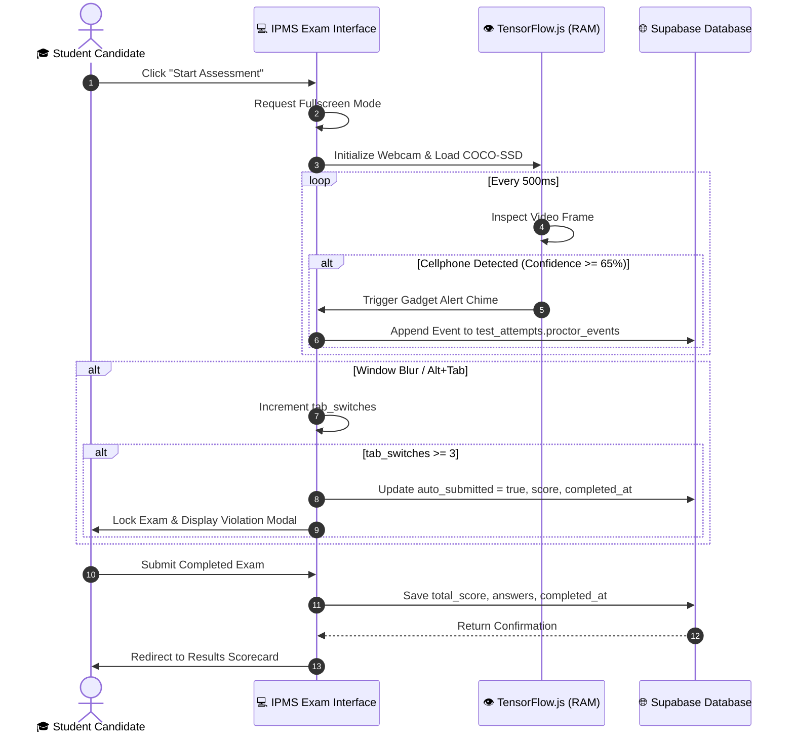
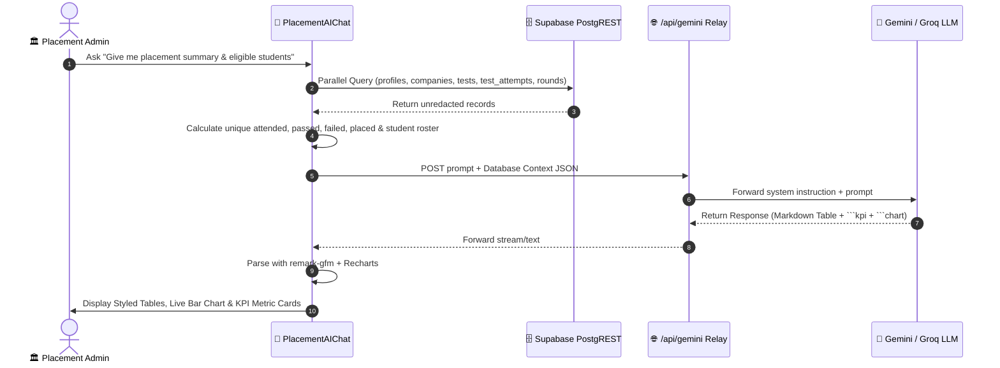

# 🏗️ System Architecture & Engineering Blueprint
## Intelligent Placement Management System (IPMS Elite)

---

### Document Control
- **Document ID**: `IPMS-ARCH-2026-V3.0`
- **Classification**: Highly Recommended Technical Reference
- **Status**: Production Approved
- **Architectural Paradigm**: Distributed Single-Page Application (SPA) + PostgREST BaaS + Serverless AI & SMTP Relays

---

## 1. System Topology & Architectural Overview

The **Intelligent Placement Management System (IPMS Elite)** operates as a distributed, event-driven web application composed of three distinct architectural tiers:

```
+-----------------------------------------------------------------------------------------+
|                                TIER 1: CLIENT PRESENTATION                              |
|   React 18.3 • TypeScript 5.8 • Vite 5.4 • Tailwind CSS v3 • shadcn/ui • Radix UI      |
|   Client-Side Neural Inference: TensorFlow.js (COCO-SSD v2.2.3 in WebGL/RAM)           |
+--------------------------------------------+--------------------------------------------+
                                             |
                     HTTPS (TLS 1.3) / WebSocket WSS / REST PostgREST
                                             |
+--------------------------------------------v--------------------------------------------+
|                         TIER 2: API & SERVERLESS EDGE RELAYS                            |
|   Vercel Serverless Functions (Node.js 20):                                             |
|   • /api/gemini      -> Groq / Gemini 2.5 Flash Proxy with Failover                     |
|   • /api/send-email  -> Nodemailer SMTP IPv4 Transport for Automated Invites            |
+--------------------------------------------+--------------------------------------------+
                                             |
                      Database Wire Protocol (pgBouncer / PostgREST)
                                             |
+--------------------------------------------v--------------------------------------------+
|                      TIER 3: DATA PERSISTENCE & SECURITY (SUPABASE)                     |
|   • PostgreSQL 15 Relational Database (Strict Foreign Keys, Unique USNs)                |
|   • Database-Level Row Level Security (RLS) Policies on Every Table                    |
|   • GoTrue Auth Service (JWT Token Verification, Role Claims)                           |
|   • Encrypted Object Storage Buckets: resumes (≤1MB), certificates (≤800KB), avatars   |
+-----------------------------------------------------------------------------------------+
```

---

## 2. Core Components & Service Communication

### 2.1 Web Presentation Engine (Frontend SPA)
- **Role-Gated Routing (`ProtectedRoute`)**: Intercepts every route transition (`/dashboard/*`, `/admin/*`, `/company/*`). Verifies the active JWT session and validates user role metadata before mounting view components.
- **Client Cache Synchronization (`TanStack Query v5`)**: Manages asynchronous server state with intelligent background invalidation, optimistic updates, and automatic caching.
- **Realtime Notification Consumer**: Subscribes to Supabase WebSocket channels (`postgres_changes` on `notifications` table) to stream live notifications directly into the UI without page reloads.

### 2.2 Client-Side Computer Vision Engine (Privacy-Preserving Anti-Cheat)
- **Engine**: `@tensorflow/tfjs` + `@tensorflow-models/coco-ssd` running MobileNetV2.
- **Communication**: Zero network transmission. Video frames are captured from `navigator.mediaDevices.getUserMedia()` into an ephemeral HTML5 `<video>` element in browser RAM.
- **Inference Pipeline**: Runs every 500ms (2 FPS). Detects objects with confidence $\ge 0.65$. If an unauthorized object (`cell phone`, `tablet`, `laptop`) or multiple faces are recognized, the engine fires an alert chime and dispatches a JSON record to `test_attempts.proctor_events`.

### 2.3 Edge Serverless Proxy Layer (`/api/gemini`)
- **Purpose**: Protects private API keys from browser inspection.
- **Communication**: Accepts `{ prompt, systemInstruction }`, attaches authorization tokens from server environment variables, and communicates upstream with Groq Cloud (`llama-3.3-70b-versatile`) or Google AI (`gemini-2.5-flash`). Returns normalized text/JSON.

### 2.4 Multi-Round Recruitment Drive Engine
- **Service**: `src/services/driveEngine.ts`.
- **Communication**: Executes pure state machine calculations on candidate scores against round passing criteria (`cutoff_score`, `top_n`, `top_percent`, `manual`).
- **Gating Logic**: Before granting candidate access to Round $N$, the engine performs an atomic check against `round_participants` for Round $N-1$ requiring `status = 'qualified'`.

---

## 3. End-to-End Data Flow Scenarios

### 3.1 Proctored Exam Execution & Anti-Cheat Telemetry


### 3.2 AI Placement Oracle Context Gathering & Generative UI


---

## 4. Hardware, Network & Platform Requirements

- **Client Devices**: Standard desktop/laptop (minimum 4 GB RAM, 2 CPU cores, functional webcam & mic).
- **Supported Browsers**: Chrome 110+, Edge 110+, Safari 16+, Firefox 115+.
- **Network Bandwidth**: Minimum 512 Kbps continuous connection for assessment submissions and WebSocket updates.
